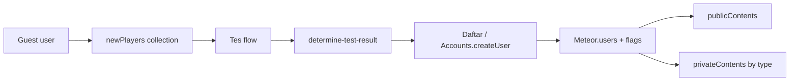

# Project structure — Persona Test Web

**Persona Test Web** (`persona-test-web` v0.8.4) is a [Meteor](https://www.meteor.com/) full-stack application that delivers an online **MBTI-style personality test**, result pages, and **career / self-development articles** (public intro content and personality-specific private content). The UI is **React 16** with **Material-UI v1**, **react-router-dom v4**, and **react-meteor-data** for subscriptions.

---

## Tech stack

| Layer | Choices |
|--------|---------|
| Runtime | Meteor (see `.meteor/release`, `.meteor/packages`) |
| UI | React, Material-UI (`@material-ui/core`, `@material-ui/icons`) |
| Routing | `react-router-dom` (client-side) |
| Data | MongoDB via `meteor/mongo` collections |
| Auth | `accounts-password`, `accounts-ui`; custom profile fields on user create |
| Session | `meteor/session`, `cultofcoders:persistent-session` |
| Tooling | ESLint (Airbnb + Meteor), Babel stage-1 preset |

**Start locally:** `npm start` → `meteor run`.

---

## Repository layout (top level)

```
persona-test-web/
├── client/                 # Meteor client bundle entry (HTML shell, CSS, main.js)
├── server/                 # Meteor server bundle entry (main.js → startup)
├── imports/                # Application code (Meteor convention)
├── private/                # Server-only JSON seed data (Assets.getText)
├── public/                 # Static assets (images, favicon)
├── .meteor/                # Meteor project config, packages, versions
├── .deploy/                # Meteor Up (mup) deployment config
├── package.json
└── jsconfig.json           # Path / editor config for `imports/`
```

Meteor loads **`client/main.js`** and **`server/main.js`**, which only re-export startup code under `imports/startup/`.

---

## `client/`

| File | Role |
|------|------|
| `main.js` | Imports `imports/startup/client/index.js` |
| `main.html` | HTML shell, meta tags (Indonesian), mount point `#app` |
| `main.css` | Global client CSS |

---

## `server/`

| File | Role |
|------|------|
| `main.js` | Imports `imports/startup/server/index.js` |

---

## `imports/` — application core

```
imports/
├── api/                    # Mongo collections, publications, methods
├── lib/                    # Shared pure helpers (client + server)
├── startup/
│   ├── client/             # React mount
│   └── server/             # Fixtures, API registration, users
└── ui/
    ├── components/         # Presentational UI pieces
    ├── containers/         # withTracker / data wiring
    ├── layouts/            # App shell, test shell, main chrome
    ├── pages/              # Route-level page components
    ├── stylesheets/        # Component-related CSS
    └── themes/             # MUI theme and color palettes
```

### `imports/startup/`

**Client (`startup/client/index.js`)**

- `Meteor.startup` → `render(<AppContainer />, #app)`.

**Server (`startup/server/index.js`)**

| Module | Role |
|--------|------|
| `fixtures.js` | On empty DB, seeds `questions`, `publicContents`, `privateContents`, and sample `newPlayers` from `private/*.json` |
| `register-api.js` | Side-effect imports of all `imports/api/*` modules |
| `user-creation.js` | `Accounts.onCreateUser` — profile, MBTI type, avatars, read flags, scores |
| `user-publication.js` | Publishes extended user fields to the client |
| `user-method.js` | Methods for content read flags and user score updates |

### `imports/api/` — data layer

Each file typically defines a `Mongo.Collection`, server **publications**, and sometimes **Meteor.methods**.

| File | Collection | Purpose |
|------|------------|---------|
| `questions.js` | `questions` | MBTI questionnaire items |
| `new-players.js` | `newPlayers` | Anonymous test sessions before registration |
| `public-contents.js` | `publicContents` | Intro / educational articles (by content `_id`) |
| `private-contents.js` | `privateContents` | Personality-type-specific articles (gated content) |

Guest flow uses **`newPlayers`**; registered users use **`Meteor.users`** with `profile`, `gameProfile`, `contentReadFlags`, and `testResult`.

### `imports/lib/` — shared logic

| Module | Purpose |
|--------|---------|
| `determine-test-result.js` | Scores answers into MBTI type and dimension percentages |
| `determine-content-percentage.js` | Progress through article sets |
| `get-personality-name.js` | Display names for types |
| `get-first-name.js` | UI formatting |
| `initial-content-read-flags.js` | Default read flags when a user registers with a type |
| `points-const.js` | Gamification point values (e.g. registration bonus) |
| `secondary-accent.js`, `smooth-scroll.js` | UI helpers |

### `imports/ui/` — presentation

**Architecture pattern:** **pages** and **layouts** hold structure; **containers** connect Meteor data (`withTracker`, subscriptions); **components** are reusable widgets.

#### Layouts

| File | Role |
|------|------|
| `layouts/App.jsx` | Top-level `Router`, MUI theme, route `Switch` |
| `layouts/MainLayout.jsx` | Header, side drawer, nested routes for test + articles |
| `layouts/TesLayout.jsx` | Layout wrapper for the test experience |

#### Containers

| File | Role |
|------|------|
| `AppContainer.jsx` | Subscribes `userData`; passes user, session flags into `App` |
| `TesContainer.jsx` | Test flow + questions subscription |
| `DaftarPageContainer.jsx` | Registration after guest test |
| `PublicContentPageContainer.jsx` | Public article by `:id` |
| `PrivateContentPageContainer.jsx` | Private article by personality + content ids |

#### Pages (routes)

| Page | Typical path / use |
|------|---------------------|
| `HomePage.jsx` | `/` — landing |
| `MulaiTesPage.jsx` | `/mulai-tes` — start test |
| `DaftarPage.jsx` | `/daftar` (via container) — sign up |
| `TesPage.jsx`, `HasilTesPage.jsx` | Used inside test container / results |
| `PublicContentPage.jsx` | `/artikel/:id` |
| `PrivateContentPage.jsx` | `/artikel/:personalityId/:contentId` |

#### Components (grouped by concern)

- **Chrome:** `Header`, `Footer`, `FooterAlt`, `MenuDrawer`, `MenuDrawerList`, `LoginDialog`
- **Test:** `QuestionList`, `QuestionItem`, `TestProgressPanel`, `TestResultPanel`, `OverallProgressPanel`, `MainResultCard`, `AlternativeResultCard`, `AttributePercentageBar`, `ShareDialog`
- **Content:** `ContentProgressPanel`, `PrevContentNavButton`, `NextContentNavButton`, `LeaderboardPanel`

Navigation targets for articles are largely defined in `MenuDrawerList.jsx` (e.g. `/artikel/mengenali-diri-sendiri`, type-colored groups, per-type private paths).

#### Themes & styles

- `themes/theme.js` — `myTheme` for `MuiThemeProvider`
- `themes/primary-color-palette.js`, `secondary-color-palette.js`, `personality-color.js`
- `stylesheets/` — transitions, circular progress, animate.css imports

---

## Routing map

```
App (BrowserRouter)
├── /                    → HomePage
├── /daftar              → DaftarPageContainer
├── /mulai-tes           → MulaiTesPage
└── /:id                 → MainLayout
        ├── /tes/:id              → TesContainer
        ├── /artikel/:id          → PublicContentPageContainer
        └── /artikel/:personalityId/:contentId → PrivateContentPageContainer
```

> **Note:** Nested paths such as `/artikel/...` and `/tes/...` require `MainLayout` to be mounted on a parent route that matches multiple segments (for example a non-exact `path="/"` route). Verify behavior in `imports/ui/layouts/App.jsx` when changing routing.

---

## `private/` — seed data (not served to clients)

Loaded at server startup via `Assets.getText` in `fixtures.js`:

| File | Seeds |
|------|--------|
| `question-data.json` | `questions` |
| `public-content-data.json` | `publicContents` |
| `private-content-data.json` | `privateContents` |

---

## `public/` — static files

Served at site root (e.g. `/img/...`):

- `img/favicon.png`, marketing / login backgrounds
- `img/avatar/mbti-avatar-*.png` — one avatar per MBTI type
- `img/content-feature/` — article feature images
- `img/illustration/` — personality “department” artwork

User profile pictures reference `/img/avatar/mbti-avatar-{type}.png` on registration.

---

## `.meteor/`

Standard Meteor metadata: package list (`mongo`, `ecmascript`, `react-meteor-data`, `accounts-password`, etc.), platform constraints, and version lockfile. Edit via `meteor add` / `meteor remove` or by hand.

---

## `.deploy/`

**Meteor Up** configuration for production (`mup.js`, `settings.json`). Contains server host, `ROOT_URL`, and MongoDB connection for deployed builds (`buildOptions.serverOnly`).

Treat deployment files as **environment-specific**; do not commit secrets to public repos without rotation.

---

## Data & user flows (high level)



1. Guest starts test → document in `newPlayers` (answers, score, result).
2. Registration copies type, score, and flags into the user document (`user-creation.js`).
3. Reading articles updates `contentReadFlags` and score via `user-method.js` methods.

---

## Conventions for contributors

- **New API surface:** add a module under `imports/api/` and import it from `imports/startup/server/register-api.js`.
- **New UI with live data:** prefer a `containers/*` wrapper with `withTracker` and a thin `pages/*` or `components/*` child.
- **Shared business rules:** put in `imports/lib/` so test scoring and UI stay aligned.
- **New static images:** under `public/img/`; reference with absolute web paths (`/img/...`).
- **Lint:** project uses `.eslintrc.json` and `@meteorjs/eslint-config-meteor`.

---

## Related files quick reference

| Concern | Location |
|---------|----------|
| npm dependencies & scripts | `package.json` |
| Client bootstrap | `imports/startup/client/index.js` |
| Server bootstrap | `imports/startup/server/index.js` |
| DB seed | `imports/startup/server/fixtures.js` |
| Root React + routes | `imports/ui/layouts/App.jsx` |
| App-wide Meteor props | `imports/ui/containers/AppContainer.jsx` |
| Authenticated shell + article/test routes | `imports/ui/layouts/MainLayout.jsx` |
